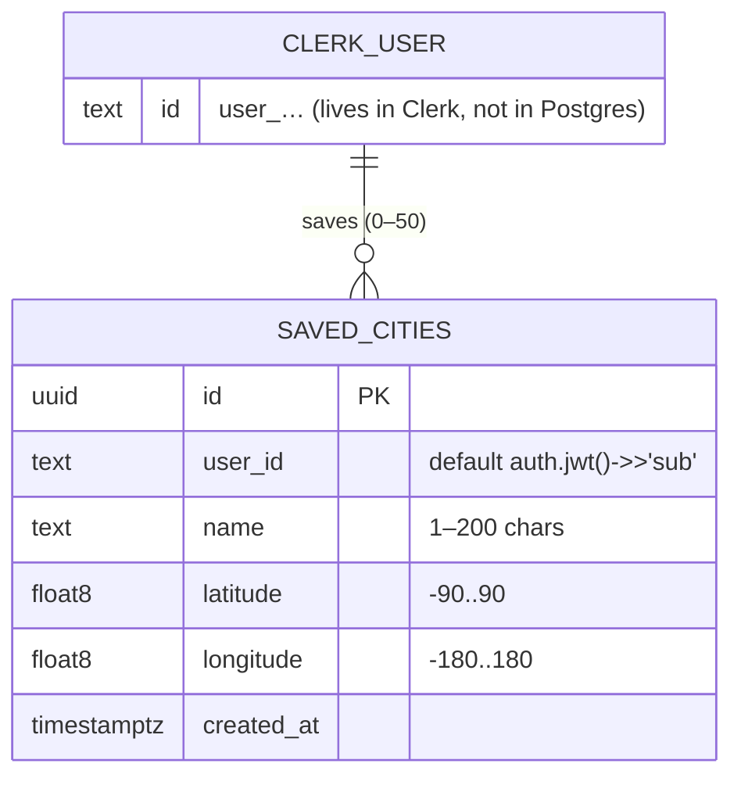
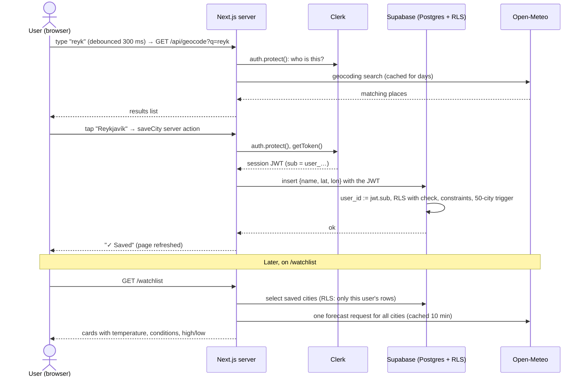

# Weather Watchlist

A small web app for keeping an eye on the weather in the cities you care about. Sign in, search for a city, save it to your list, and see the current temperature, conditions, and today's high and low for every saved city. Each person sees only their own list, and it's still there the next time they sign in.

Built for MPCS 51238 Assignment 4 with Next.js 16, Clerk, Supabase and [Open-Meteo](https://open-meteo.com/).

## Data model

One table, `public.saved_cities`. Each row belongs to exactly one person: `user_id` is their Clerk user ID, filled in from their session token.



- `unique (user_id, latitude, longitude)` stops the same city being saved twice.
- Check constraints and a `before insert` trigger (max 50 per user) enforce the input rules in the database, because signed-in users can call Supabase directly with their own token.
- Weather is **not** stored. It's fetched when the watchlist is viewed.
- Migrations are in [`supabase/migrations/`](supabase/migrations/).

## Request flow: saving a city



## Where the API call happens, and why

All Open-Meteo calls run **on the server**: search goes through `app/api/geocode/route.ts`, and the watchlist page fetches weather itself. The code is in [`lib/open-meteo.ts`](lib/open-meteo.ts).

- **Caching.** Results are cached with `use cache`: geocoding for days, weather for 10 minutes. This keeps the app well under Open-Meteo's free limits.
- **One place for the API-down state.** Every call has a 5-second timeout and checks the HTTP status. Any failure turns into one clear "service down" message with a Retry button. Failures are never cached, so Retry really tries again.
- **No key, but errors still handled.** Open-Meteo needs no API key, so this isn't about hiding a secret. It's about consistent error handling and caching. The response quirks are handled in one place: no matches come back as `200` with no `results` key, and one location returns an object while several return an array.

## Recommendations

Each city card has **Wear / Bring / Ideas**, and the top of `/watchlist` has a **Today's brief**: one line per city on what to wear, plus the best saved city for outdoor plans today. They come from rules only, in [`lib/recommendations.ts`](lib/recommendations.ts): pure functions with no AI model, no new tables and no user data. The inputs are the public forecast: feels-like, conditions, day or night, today's high and low, rain chance, wind and UV.

- **Wear** follows feels-like temperature: from "Heavy coat, hat, gloves and scarf" (≤ −10 °C) to "Light, breathable clothes" (> 26 °C), plus boots in snow.
- **Bring:**
  - An umbrella if rain chance is ≥ 60% or it's raining. A hooded jacket instead if wind is ≥ 40 km/h.
  - A compact umbrella at 30–59%.
  - A windproof layer at ≥ 30 km/h.
  - Sunscreen at UV ≥ 3, plus sunglasses and a hat at UV ≥ 6.
  - An extra layer if the day spans 10 °C or more.
- **Ideas:** 2–3 outdoor and indoor picks.
  - Storms remove outdoor ideas, and nights switch to evening ideas.
  - If it's raining now, the idea is a walk between showers. If it's dry now but showers are likely later, it's "Get outside now, before the showers".
- **Best for outdoor plans:** a 0–100 score that starts at 100 and loses points for rain chance, distance of today's high from 21 °C, wind above 20 km/h, storms and very high UV. Below 40 everywhere, the brief suggests an indoor day.

The rules work in metric and their text contains no numbers. The **°F (default) / °C toggle** therefore converts only for display, in the browser, and is remembered in `localStorage`. Forecasts stay cached by coordinates alone, never by user or unit.

`e2e/recommendations.spec.ts` checks hand-computed examples (hot sunny day, raining now, snowy night, mild but windy, dry now with showers later, thunderstorm, best city) without signing in: `npx playwright test e2e/recommendations.spec.ts`.

## Access control

- **Who you are: Clerk.** On the server, `auth()` / `auth.protect()` from `@clerk/nextjs/server` reads the Clerk session. Every page, route handler and server action that touches data calls `auth.protect()`. Signed-out visitors are sent to sign-in (pages) or get a 404 (API and actions). The home and sign-in/up pages show no data.
- **What you can see: RLS in Postgres.** The Supabase client ([`lib/supabase/server.ts`](lib/supabase/server.ts)) forwards the Clerk session token through supabase-js `accessToken`. Supabase verifies it (Clerk is set up as a third-party auth provider). Then the row-level security policies on `saved_cities` compare `(select auth.jwt()) ->> 'sub'` with `user_id`, for SELECT, INSERT (`with check`) and DELETE. There's no UPDATE policy, so updates are denied, and signed-out (`anon`) requests have no policies at all. Even if the app code forgot a filter, Postgres would still return only your rows.

## Testing

`e2e/watchlist-isolation.spec.ts` is one Playwright test that uses two real Clerk test users (`@clerk/testing`):

1. User A signs in, searches "Reykjavik", and saves it. The test confirms the row has A's `user_id`.
2. User B signs in separately and opens `/watchlist`. Reykjavík must **not** appear.
3. B's own Clerk token is used to query Supabase directly. Fetching A's row by `id`, or any row with a different `user_id`, must return `[]`.
4. A's row is deleted afterwards.

**Proving it works.** I temporarily added this policy through the Supabase MCP. It was never a migration and never committed:

```sql
create policy "TEMP BROKEN - anyone can read every row"
  on public.saved_cities for select to authenticated using (true);
```

Postgres combines policies with OR, so every signed-in user could now read every row. The test failed on both checks:

```
✘  1 [chromium] › e2e/watchlist-isolation.spec.ts:40:5 › user B cannot see user A's saved city (15.6s)
  Error: A's city on B's watchlist
  expect(locator).toHaveCount(expected) failed
  Locator:  getByRole('heading', { name: /Reykjav[ií]k/ })
  Expected: 0
  Received: 1

  Error: B fetched A's row by id
  expect(received).toEqual(expected) // deep equality
  - Array []
  + Array [
  +   Object {
  +     "id": "e3cf2d61-1e82-4393-85ef-8258153b379d",
  +   },
  + ]
  1 failed
```

**Fix:** dropped the broken policy. Only the three migration policies remain, the Supabase security advisor reports no findings, and the test passes again.

Two decisions in the test:
- Sign-in uses `clerk.signIn({ emailAddress })`, which creates a one-time token through Clerk's backend. The password strategy stops at Clerk's `needs_client_trust` step, because every Playwright browser counts as a new device.
- The watchlist check is a soft assertion, so the direct-Supabase checks still run and report when it fails.

## Security review

`/security-review` on `feature/watchlist` found **no vulnerabilities at 8/10 confidence or higher**. A full git-history search for key patterns found no keys. The only hit was an npm `sha512-` integrity hash that happens to contain "eyJ". `npm audit --omit=dev` reports 0 vulnerabilities.

Lower-confidence observations, and what I did about each:

| Observation | Matters for a class app on free tiers? | Action |
|---|---|---|
| Signed-in users can call Supabase directly with their own token, skipping the server action's input checks | Yes. Someone could store junk or huge values in their own rows | **Fixed:** check constraints (name length, lat/lon ranges) in a migration |
| No limit on how many cities one user can save | Yes. Unbounded rows would eat the 500 MB database, and one batched forecast URL per watchlist would grow without limit | **Fixed:** `before insert` trigger caps each user at 50; the watchlist query is limited to 50 |
| App could be framed by another site (clickjacking on Save/Remove) | A little. Cheap to prevent | **Fixed:** `frame-ancestors 'none'`, `X-Frame-Options: DENY`, `nosniff`, referrer policy; removed `X-Powered-By` |
| No rate limit on `/api/geocode` | A little. Only signed-in users can call it, results are cached per query, and Open-Meteo limits are per IP | **Not fixed:** reliable rate limiting on serverless needs a shared store (new service or package) |
| No full Content-Security-Policy | Low. React escapes output and there's no `dangerouslySetInnerHTML` | **Not fixed:** a full CSP that works with Clerk needs nonces on every page |
| Error messages | No. Responses are already generic; Supabase and Open-Meteo errors are never sent to the browser | No change |
| Search input limits | No. Already 2–100 characters, checked on the server | No change |

## Free tiers

| Service | Limits that could matter here | Usage limits and alerts |
|---|---|---|
| **Vercel Hobby** | Non-commercial personal use only. Per month: 1M function invocations, 4 h Active CPU, 360 GB-hrs provisioned memory, 100 GB Fast Data Transfer, 10 GB Fast Origin Transfer. Runtime logs kept 1 hour. | Hobby can't be charged. Usage notifications are automatic. Check **Dashboard → Usage** or run `vercel usage`. Spend Management (custom amount, pause projects) is Pro-only. |
| **Supabase Free** | 500 MB database, 5 GB egress, 50,000 MAU, 2 active projects. **A free project is paused after 7 days without use**; restore it from the dashboard (data is kept). | The Free plan is never charged. Watch **Organization → Usage** (`supabase.com/dashboard/org/_/usage`). The Spend Cap is Pro-only. The 50-city cap keeps the table small. |
| **Clerk Hobby** | **Development instances (what this app uses, including on Vercel) are capped at 100 users**, plus 100 Backend API requests per 10 s. Production Hobby allows 50,000 monthly retained users per app. | No billing on Hobby and no usage alerts. Check the user count in **Dashboard → Users**. Past 100 dev users, sign-ups stop working. |
| **Open-Meteo** | Free for non-commercial use only: 600 calls/min, 5,000/hour, 10,000/day, 300,000/month, counted by IP and application. Shared hosts like Vercel can hit limits sooner. | No account or key, so there's no dashboard or alerts. Server-side caching (weather 10 min, geocoding days) and one batched request per watchlist keep calls low. If limited, the app shows its "service down" state. |

## Running locally

1. `npm install`
2. Create `.env.local`. It's git-ignored and Claude Code is denied read access in `.claude/settings.json`. It needs these **variable names** (values come from the Clerk and Supabase dashboards; never commit them):
   - `NEXT_PUBLIC_CLERK_PUBLISHABLE_KEY`, `CLERK_SECRET_KEY`: Clerk **development** instance
   - `NEXT_PUBLIC_CLERK_SIGN_IN_URL`, `NEXT_PUBLIC_CLERK_SIGN_UP_URL`: written by `clerk init`
   - `NEXT_PUBLIC_SUPABASE_URL`, `NEXT_PUBLIC_SUPABASE_PUBLISHABLE_KEY`
   - For the e2e test: `E2E_USER_A_EMAIL`, `E2E_USER_B_EMAIL` (two users in the Clerk dev instance). `E2E_USER_A_PASSWORD` and `E2E_USER_B_PASSWORD` exist but aren't used by the current sign-in method.
3. Supabase: apply the migrations in `supabase/migrations/` in order. Then connect Clerk as a third-party auth provider (Clerk Dashboard → Integrations → Supabase → Activate; Supabase → Authentication → Sign In / Providers → Third-Party Auth → Clerk).
4. `npm run dev` and open http://localhost:3000
5. Tests: `npx playwright install chromium` once, then `npm run test:e2e`

## Designed states

| State | Search page | Watchlist page |
|---|---|---|
| **Loading** | Skeleton rows while a search is in flight (after the 300 ms debounce; older requests are cancelled) | `loading.tsx` skeleton cards while saved cities and weather load |
| **Nothing found** | "No cities found for '…'", with a hint to check spelling | "No saved cities yet", with a button to search |
| **API down** | "City search is down", with **Try again** | "Weather service is down", with **Try again**; saved cities stay listed and removable. A separate message covers a database error. |
